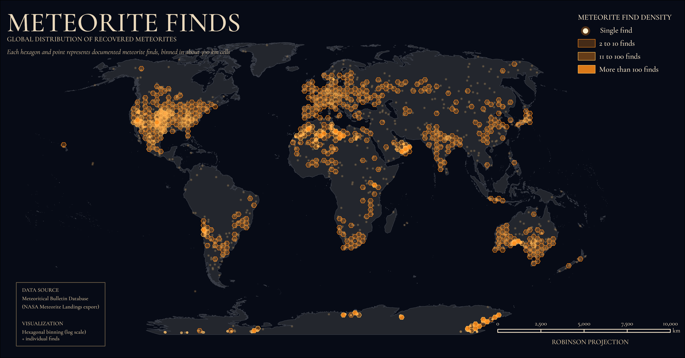

# Meteorite

# Meteorite Finds

A global map of recovered meteorites, built in **ArcGIS Pro** with hexagon binning and glowing points on a dark navy background.



This README is a step-by-step tutorial. If you follow it from top to bottom you will end up with the same map.

**What the map shows:** every documented meteorite find with coordinates, grouped into hexagonal cells of about 300 km. Cells with two or more finds are drawn as hexagons in three density classes. Cells with exactly one find are drawn as single glowing dots.

---

## Contents

1. [What you need](#1-what-you-need)
2. [Get the data](#2-get-the-data)
3. [Clean the data](#3-clean-the-data)
4. [Set up the ArcGIS Pro project](#4-set-up-the-arcgis-pro-project)
5. [Build the points and hexagons with Python](#5-build-the-points-and-hexagons-with-python)
6. [Separate the single finds](#6-separate-the-single-finds)
7. [Add the land layer](#7-add-the-land-layer)
8. [Style the layers](#8-style-the-layers)
9. [Build the layout](#9-build-the-layout)
10. [Export](#10-export)
11. [What the map shows and its limits](#11-what-the-map-shows-and-its-limits)
12. [Troubleshooting](#12-troubleshooting)
13. [Credits and licences](#13-credits-and-licences)

---

## 1. What you need

- ArcGIS Pro (menu names can differ slightly between versions)
- Python, either the copy that comes with ArcGIS Pro or any Python with `pandas` installed (used for the cleaning step)
- The **Cormorant Garamond** font (free, optional, see [step 9](#9-build-the-layout))
- About 2 to 3 hours

Suggested folder layout:

```
meteorite-finds/
├── README.md
├── images/
│   └── MeteoriteFind.png
├── scripts/
│   ├── clean_data.py
│   └── prep_hexbins.py
└── Raw Data/
    ├── meteorites.csv
    └── meteorite_landings_clean.csv
```

The paths in the scripts below use a Windows project folder. Change them to match your own.

---

## 2. Get the data

The dataset is **NASA's Meteorite Landings**, which comes from the Meteoritical Bulletin Database kept by the Meteoritical Society. It has 45,716 records.

I used a copy of it from the TidyTuesday repository:

```
https://raw.githubusercontent.com/rfordatascience/tidytuesday/main/data/2019/2019-06-11/meteorites.csv
```

Download it and save it as `meteorites.csv` in your `Raw Data` folder.

Columns: `name`, `id`, `name_type`, `class`, `mass`, `fall`, `year`, `lat`, `long`, `geolocation`.

**Note on the data age.** This is an older snapshot of the database. The Meteoritical Society's own website has a more recent export if you want up-to-date counts.

---

## 3. Clean the data

The raw file has three problems:

| Problem | Records |
|---|---|
| No coordinates at all | 7,315 |
| Coordinates set to exactly `0, 0` (a placeholder in the Gulf of Guinea, not a real find) | 6,214 |
| Latitude or longitude out of range | 1 |

Removing them leaves **32,186** usable points.

Save this as `scripts/clean_data.py` and run it. Edit the folder path first.

```python
import pandas as pd

folder = r"C:\GISProjects\meteorite-finds\Raw Data"

d = pd.read_csv(folder + r"\meteorites.csv")
print("raw records:", len(d))

d = d.dropna(subset=["lat", "long"])                  # no coordinates
d = d[~((d.lat == 0) & (d.long == 0))]                # 0,0 placeholders
d = d[d.lat.between(-90, 90) & d.long.between(-180, 180)]

keep = ["name", "id", "class", "mass", "fall", "year", "lat", "long"]
d[keep].to_csv(folder + r"\meteorite_landings_clean.csv", index=False)
print("clean records:", len(d))
```

You should see `raw records: 45716` and `clean records: 32186`.

---

## 4. Set up the ArcGIS Pro project

1. Create a new **Map** project in ArcGIS Pro and save it in your project folder. A new project creates a default geodatabase, and the script in step 5 writes its outputs there.
2. In the Contents pane, remove the default **Topographic** basemap. It would add an Esri credit line and a light background you do not want.
3. Right-click the map, open **Properties**, then **Coordinate Systems**, and choose **Projected Coordinate System, World, Robinson (World)** (WKID 54030).

**Why Robinson?** It gives the familiar rounded world look and is a good fit for a poster-style map. It is not an equal-area projection, so shapes and areas near the poles are slightly distorted. If you need strict area accuracy for a density map, use **Equal Earth** (WKID 8857) instead and change `54030` to `8857` in the script. Keep the map and the hexagons in the same projection or the hexagons will look stretched.

---

## 5. Build the points and hexagons with Python

This script does the data work for you:

1. loads the cleaned CSV as points,
2. projects them to Robinson,
3. builds a hexagon grid of about 300 km,
4. counts the finds in every hexagon,
5. keeps only the hexagons with two or more finds,
6. adds a density class field,
7. adds the results to your map.

Save it as `scripts/prep_hexbins.py`.

```python
import os
import arcpy

# ---- settings ----
folder = r"C:\GISProjects\meteorite-finds\Raw Data"
csv_path = os.path.join(folder, "meteorite_landings_clean.csv")
hex_area = "58500 SquareKilometers"   # about 300 km across

assert os.path.exists(csv_path), f"CSV not found: {csv_path}"

aprx = arcpy.mp.ArcGISProject("CURRENT")
gdb = aprx.defaultGeodatabase
arcpy.env.workspace = gdb
arcpy.env.overwriteOutput = True
m = aprx.activeMap

robinson = arcpy.SpatialReference(54030)   # World Robinson
wgs84 = arcpy.SpatialReference(4326)

# 1. CSV to points (WGS 1984)
pts_wgs = arcpy.management.XYTableToPoint(csv_path, "met_points_wgs", "long", "lat",
                                          coordinate_system=wgs84)
print("points:", arcpy.management.GetCount(pts_wgs)[0])

# 2. Project to Robinson
pts = arcpy.management.Project(pts_wgs, "met_points", robinson)

# 3. Hexagon grid over the points
ext = arcpy.Describe(pts).extent
hexes = arcpy.management.GenerateTessellation("met_hex_grid", ext, "HEXAGON",
                                              hex_area, robinson)

# 4. Count finds per hexagon (empty hexagons are dropped)
counted = arcpy.analysis.SummarizeWithin(hexes, pts, "met_hex_count",
                                         "ONLY_INTERSECTING")

# 5. Keep hexagons with 2 or more finds (single finds stay as points)
multi = arcpy.analysis.Select(counted, "met_hex", "Point_Count > 1")

# 6. Density class for symbology
arcpy.management.AddField(multi, "Density", "TEXT", field_length=20)
arcpy.management.CalculateField(multi, "Density", "classify(!Point_Count!)", "PYTHON3",
"""def classify(n):
    if n <= 10:
        return "2 to 10 finds"
    elif n <= 100:
        return "11 to 100 finds"
    return "More than 100 finds"
""")

# 7. Set map to Robinson and add the layers
m.spatialReference = robinson
m.addDataFromPath(os.path.join(gdb, "met_hex"))
m.addDataFromPath(os.path.join(gdb, "met_points"))
print("done")
```

### How to run it

**Option A: the Python window (most reliable).**

1. Open your project, then go to the **View** tab and click **Python Window**.
2. Paste this one line at the `>>>` prompt and press Enter:

```python
exec(open(r"C:\GISProjects\meteorite-finds\scripts\prep_hexbins.py").read())
```

**Option B: a notebook.** On the **Insert** tab choose **New Notebook**, paste the whole script into a cell and press Shift+Enter. If the notebook opens as a blank white page, see [Troubleshooting](#12-troubleshooting).

The script prints the point count (32186) and then `done`.

### What the script created

| Layer | What it holds |
|---|---|
| `met_points_wgs` | All 32,186 points in WGS 1984 (not used on the map, safe to remove) |
| `met_points` | All points projected to Robinson |
| `met_hex_grid` | The full empty hexagon grid (not used, safe to remove) |
| `met_hex_count` | Hexagons that contain at least one find (not used, safe to remove) |
| `met_hex` | Hexagons with two or more finds, with `Point_Count` and `Density` fields |

Running the script twice adds duplicate layers to the map. Remove the extras from the Contents pane.

---

## 6. Separate the single finds

At the moment `met_points` draws every point, including the ones already counted inside hexagons. In dense areas this piles dots on top of the hexagons and hides them. The single-find dots should only be the points that sit outside every hexagon.

Of the 32,186 points, **30,875** fall inside a hexagon, which leaves **1,311** true single finds.

1. Rename `met_points` to `Single find` (click it and press F2) so you have one points layer to work from.
2. On the **Map** tab click **Select By Location**.
3. Set **Input Features** to `Single find`, **Relationship** to **Intersect**, and **Selecting Features** to `met_hex`. Click **Run**. The status bar at the bottom of the map should show **30,875** selected.
4. On the **Map** tab, in the Selection group, click **Switch Selection**. The status bar should now show **1,311**.
5. Right-click `Single find`, choose **Data**, then **Export Features**. Make sure **Use selected records** is ticked, name the output `met_singles`, and click Run.
6. Open the attribute table of `met_singles` and confirm it has 1,311 records. If it shows 32,186, the export ignored your selection, so run it again with the option ticked.
7. Remove the old all-points `Single find` layer, rename `met_singles` to `Single find`, and click **Clear** on the Map tab to remove the selection.

Keep a second copy of the full points layer for the glow in step 8. A quick way is to run `prep_hexbins.py` again, or to add `met_points` back from the geodatabase through the Catalog pane.

---

## 7. Add the land layer

1. Download **Natural Earth 10m Land** (Downloads, Physical, Land) from [naturalearthdata.com](https://www.naturalearthdata.com) and unzip it.
2. Add `ne_10m_land.shp` to the map.
3. Set its fill to `#23262D` and its outline to `#3A3E48`, 0.5 pt.
4. Move it to the bottom of the drawing order.

Natural Earth is in the public domain.

---

## 8. Style the layers

All colours are hex codes. In ArcGIS Pro you can type a hex code in **Color Properties** (open the colour picker and choose **Color Properties** at the bottom).

### Drawing order (top to bottom)

1. `Single find`
2. `met_hex`
3. `Glow small` (a copy of the full points layer)
4. `Glow big` (another copy of the full points layer)
5. `ne_10m_land`

### Hexagons (`met_hex`)

Open **Symbology**, choose **Unique Values**, and set the field to `Density`. Put the classes in order from lowest to highest. Set each class symbol as follows, with a stroke of `#FFBF59` at 0.5 pt:

| Class | Fill colour | Fill transparency |
|---|---|---|
| 2 to 10 finds | `#FF8C1A` | about 75% |
| 11 to 100 finds | `#FF8C1A` | about 62% |
| More than 100 finds | `#FF8C1A` | about 15% |

Click **Apply** when you finish. **Auto Apply** is switched off by default, so nothing changes until you do.

### Single find dots

Colour `#FFF1D0`, size about 1.5 pt, no outline. Remove the outline by unticking the **Solid stroke** symbol layer in the **Layers** tab of the symbol properties.

### The glow

The glow is two copies of the full points layer drawn underneath the hexagons, with soft transparent orange symbols. **Screen** blending makes overlapping glow add up like light, instead of piling up as flat orange.

| Layer | Fill colour | Size | Fill transparency |
|---|---|---|---|
| `Glow small` | `#FFB347` | about 3 pt | about 80% |
| `Glow big` | `#FF8C1A` | about 7 pt | about 92% |

For both layers:

1. Untick the **Solid stroke** symbol layer so there is no outline.
2. Select the layer, go to the **Appearance** tab and set **Layer Blend** to **Screen**.

These sizes are starting points. If the glow hides the hexagons in dense areas such as the US and Europe, make the glow weaker. If the map looks flat, make it a little stronger.

---

## 9. Build the layout

### The page

1. On the **Insert** tab choose **New Layout**, then **Custom Page Size**.
2. Set the page to **12.5 in wide and 6.54 in tall**. This has the shape of a wide LinkedIn image and exports sharply.
3. On the **Insert** tab choose **Map Frame**, pick your map and drag it across the whole page. The frame handles should sit on the page edges.

### The background

Make the whole page navy `#070B16`. You can either set the map frame background to that colour, or draw a full-page rectangle behind the map frame (Insert, Graphics, Rectangle, fill `#070B16`, no outline) and drag it below the map frame in the Contents pane. If the frame background is greyed out, use the rectangle.

Switch off any layer that draws a coloured ellipse behind the world, such as a global background layer.

### Fit the world

1. In the **Element** panel for the map frame, set the **Scale** (for example `110000000`) so the world fills the page width.
2. Double-click the frame to activate it and drag the map until Antarctica sits just inside the bottom edge. Leave empty ocean at the top left for the title, and a clear patch at the top right for the legend.
3. Click outside the frame to deactivate it.

### Fonts

The title uses **Cormorant Garamond**, a free font. To install it on Windows:

1. Download it from [fonts.google.com](https://fonts.google.com) (**Download family**) and extract the zip.
2. Open the extracted folder, then double-click a `.ttf` file such as `CormorantGaramond-Medium.ttf`. In the preview window click **Install**. Repeat for `CormorantGaramond-Regular.ttf`.
3. Close ArcGIS Pro completely and reopen it. Pro only reads the font list when it starts.

Georgia is a good substitute if you do not want to install anything.

### Text

Add each with **Insert, Text** and set the font in the **Element** panel, **Text Symbol** section.

| Text | Font | Size | Colour |
|---|---|---|---|
| `METEORITE FINDS` | Cormorant Garamond Medium | about 36 pt | `#EAD9BD` |
| `GLOBAL DISTRIBUTION OF RECOVERED METEORITES` | Cormorant Garamond | about 9 pt | `#C9B79A` |
| `Each hexagon and point represents documented meteorite finds, binned in about 300 km cells.` | Cormorant Garamond Italic | about 9 pt | `#C9B79A` |

### Legend

1. On the **Insert** tab choose **Legend** and draw it in the top right.
2. In the **Element** panel, open **Items** and keep only `Single find` and `met_hex`. The glow layers should not appear.
3. For each item, untick **Layer name** and **Headings**, so the word `Density` and the layer name disappear.
4. Set the legend title to `METEORITE FIND DENSITY`.
5. Set the text to Cormorant Garamond, about 10 pt, colour `#EBDCC4`, and the patch size to about 18 x 10 pt.
6. Put the hexagon classes in order from lowest to highest by dragging them in the `met_hex` Symbology.
7. If the dot beside `Single find` is too small to see, enlarge the dot symbol a little.

### Data source box (bottom left)

1. Draw a rectangle (**Insert, Graphics, Rectangle**) with fill `#070B16` and outline `#6B5D48` at 0.5 pt. Make it wide and tall enough that no text touches its edges.
2. Add these text lines on top, using `#EBDCC4` for the headings and `#C9B79A` for the details, at about 9 pt:

```
DATA SOURCE
Meteoritical Bulletin Database
(NASA Meteorite Landings export)

VISUALIZATION
Hexagonal binning (log scale)
+ individual finds
```

### Scale bar

1. On the **Insert** tab choose **Scale Bar**, then **Alternating Scale Bar 1**, and click the map frame.
2. In the **Element** panel, set:
   - **Fitting Strategy:** Adjust width
   - **Division Value:** 2500
   - **Divisions:** 4
   - **Subdivisions:** 0
   - **Numbers, Frequency:** Divisions
   - **Units:** Kilometers (label `km`)
3. Set the two alternating bar colours to `#EBDCC4` and `#0B0F1A`, with a thin cream outline so the dark segments do not vanish into the background.
4. Set the text to 8 pt in `#EBDCC4`, and move the bar so it does not sit on top of the bright Antarctic finds.
5. Add a text element below it: `ROBINSON PROJECTION`, in `#C9B79A`.

The scale in a Robinson map is only true along the equator, so it is a rough guide.

---

## 10. Export

1. On the **Share** tab choose **Export Layout**.
2. Set the file type to **PNG** and the resolution to **300 dpi**.
3. Save it as `MeteoriteFind.png`.

Open the exported file at 100% and check:

- the text inside the data source box does not touch the border,
- the `Single find` dot in the legend is visible,
- Antarctica is not cut off at the bottom,
- the hexagon outlines are visible in dense areas such as the US and Europe.

---

## 11. What the map shows and its limits

**What stands out.** The biggest hotspots are not near cities. They are places where meteorites are easy to spot and well preserved: the Antarctic ice (about 22,000 of the records are south of 60 degrees south), the Sahara, Oman, the Nullarbor Plain in Australia and the Atacama Desert in Chile.

**Limits to keep in mind:**

- **Search effort, not landing rates.** Finds show where people look and report, not where meteorites fall. Meteorites land everywhere. The strong cover in the US and Europe is partly because more people are looking.
- **An older snapshot of the data.** The NASA export does not include recent additions to the Meteoritical Bulletin.
- **Records without coordinates are left out.** About 7,300 records had no location and about 6,200 were placeholders at `0, 0`.
- **Hexagon size is not equal-area on this projection.** In Robinson, hexagons near the poles cover less real ground than ones near the equator. This matters most for the Antarctic finds.
- **Binning depends on the cell size.** A different hexagon size changes where the clusters appear.

---

## 12. Troubleshooting

**The notebook opens as a blank white page.**
A notebook in ArcGIS Pro starts a local Jupyter server and shows it inside an embedded browser component (WebView2). If the page stays blank:

- Wait a full minute after opening it.
- Update or repair Microsoft Edge WebView2. If the installer says it failed because it is already installed, that is normal and not the cause.
- Close Pro, rename the `.jupyter` folder in your user profile (for example to `.jupyter_old`), and reopen Pro.
- Try running Pro as administrator once, or pause antivirus software briefly to check if it is blocking the local server.
- Run the script from the **Python window** instead (see [step 5](#5-build-the-points-and-hexagons-with-python)).

**Windows will not show "Install" when I right-click the font files.**
Make sure you extracted the zip first (right-click it, **Extract All**). Then double-click a `.ttf` file and use the **Install** button in the preview window. On Windows 11 you can also open **Fonts settings** and drag the files into the box.

**The map shows a huge grid of hexagons over the whole world.**
You are looking at `met_hex_grid` (the empty grid) or `met_hex_count`. Remove those layers and keep only `met_hex`.

**The hexagons look like fuzz or are hidden.**
The glow layers are too strong in dense areas. Make `Glow small` and `Glow big` smaller and more transparent. Also check the hexagon layer sits above the glow layers in the drawing order, and zoom in to judge hexagons at layout size, not in the small map view.

**The legend says `met_singles` or shows the wrong items.**
Rename the layer in the Contents pane (select it, press F2). The legend follows the layer name. Check the legend **Items** list in the Element panel.

**Changes to a symbol do nothing.**
In the Symbology pane, **Auto Apply** is off by default. Click **Apply**.

**The scale bar shows only 0 to 5,000 km.**
Set **Fitting Strategy** to **Adjust width**, **Divisions** to 4 and **Subdivisions** to 0.

---

## 13. Credits and licences

- **Meteorite data:** Meteoritical Bulletin Database (The Meteoritical Society), via NASA's Meteorite Landings dataset. Copy used from the [TidyTuesday repository](https://github.com/rfordatascience/tidytuesday).
- **Land polygons:** [Natural Earth](https://www.naturalearthdata.com), public domain.
- **Font:** Cormorant Garamond, released under the SIL Open Font License.
- **Software:** ArcGIS Pro (Esri).
- **Map and tutorial:** Melanie van Enter.
